# Analisis Sentimen dan Ekstraksi Topik Keluhan pada 100.000 Ulasan Aplikasi Gojek di Google Play Store

> **Status berkas.** Ini **draf berbasis data**, bukan naskah siap serah. Seluruh
> angka dihitung ulang dari `docs/tables/*.csv` dan `ml/artifacts/reports/*.json`
> melalui `python -m ml.src.collect_facts`, lalu diverifikasi terhadap
> `docs/synthesis/facts.yaml` oleh `python -m ml.src.verify_manuscript`.
> Setiap klaim numerik membawa komentar rujukan `<!-- src: ... -->` yang tidak
> tampil saat di-*render*. Tanggung jawab akademik atas isi naskah ada pada
> penulis (H-11).
>
> **Cara memakai berkas ini.** Setiap bagian diawali penanda
> `<!-- ===== §x ... — SIAP TEMPEL ===== -->` sehingga dapat dipotong per bagian
> dan ditempel ke dokumen utama tanpa membaca ulang seluruh berkas. Tabel ditulis
> sebagai tabel markdown agar dapat disalin ke pengolah kata tanpa mengetik ulang.

---

<!-- ===== §0 Abstrak — SIAP TEMPEL ===== -->

## Abstrak

Ulasan pengguna di toko aplikasi adalah sumber umpan balik berskala besar yang
tidak terstruktur: 100.000 ulasan aplikasi Gojek pada 21 Mei 2024 – 31 Desember
2025 tidak dapat dibaca satu per satu, sehingga keluhan yang berulang tidak
terdeteksi secara sistematis. <!-- src: docs/tables/profil_dataset.csv -->
Penelitian ini melatih dan membandingkan tiga keluarga algoritma klasik dengan
empat varian — ComplementNB, MultinomialNB, LinearSVC, dan LogisticRegression —
di atas representasi TF-IDF 1–2 gram, dengan skema label biner yang diturunkan
dari rating bintang, serta menerapkan **protokol evaluasi ganda**: setiap model
dilaporkan pada test set penuh dan pada subset ulasan berisi minimal lima kata.
<!-- src: docs/tables/model_metrics.csv --> Model produksi
(LogisticRegression, `C=1.0`) mencapai macro-F1 0,9336 dan recall kelas negatif
0,9315 pada test set penuh, jauh di atas baseline kelas mayoritas 0,4196, dengan
rentang antar-keempat varian hanya 1,88 poin.
<!-- src: docs/tables/model_metrics.csv; facts.yaml model.rentang_macro_f1_tuned -->
Temuan metodologis utamanya adalah selisih 2,59 poin macro-F1 antara kedua set
evaluasi: karena 39,9% ulasan hanya berisi dua kata atau kurang dan hampir
seluruhnya positif, metrik pada test set penuh melebih-lebihkan kemampuan model.
<!-- src: facts.yaml model.produksi.selisih_macro_f1_poin; docs/tables/ulasan_pendek.csv -->
Ekstraksi topik dengan LDA atas korpus negatif menghasilkan sembilan kategori
keluhan; dua teratas — ketersediaan mitra driver (36,15% ulasan negatif) dan
pesanan GoFood beserta pembatalannya (34,25%) — menguasai dua pertiga korpus
keluhan. <!-- src: docs/tables/topics_ranked.csv -->

**Kata kunci:** analisis sentimen, bahasa Indonesia, ulasan aplikasi,
ketidakseimbangan kelas, TF-IDF, pemodelan topik LDA.

---

<!-- ===== §1 Pendahuluan — SIAP TEMPEL ===== -->

## 1. Pendahuluan

### 1.1 Latar belakang

Aplikasi super seperti Gojek menerima umpan balik pengguna dalam volume yang
tidak mungkin dibaca manual. Kolom ulasan di Google Play menampung keluhan,
pujian, dan laporan bug dalam satu aliran teks bebas berbahasa Indonesia
sehari-hari — bercampur singkatan, slang, dan emoji. Rating bintang memberi
ringkasan kasar, tetapi tidak memberi tahu **apa** yang dikeluhkan. Dua ulasan
bintang satu dapat berasal dari dua masalah yang sama sekali berbeda: satu
tentang driver yang tidak kunjung didapat, satu lagi tentang saldo yang hilang.

Analisis sentimen otomatis menjawab sebagian persoalan itu, tetapi hanya
sebagian. Klasifikasi positif–negatif memberi volume; yang dibutuhkan untuk
tindakan adalah **tema** keluhan beserta peringkatnya. Penelitian ini mengerjakan
keduanya pada satu korpus yang sama, dan menyambungkan hasilnya ke *dashboard*
yang dapat ditelusuri sampai ke teks ulasan aslinya.

### 1.2 Rumusan masalah

**RM1.** Model klasifikasi mana yang lebih baik untuk sentimen ulasan Gojek
berbahasa Indonesia — Naive Bayes, SVM, atau Logistic Regression — dan seberapa
besar perbedaannya bila diukur dengan protokol yang identik?

**RM2.** Apa saja tema keluhan dominan dalam ulasan negatif, dan bagaimana
peringkatnya?

### 1.3 Batasan

Penelitian ini dibatasi pada:

- satu korpus statis 100.000 ulasan berbahasa Indonesia periode 21 Mei 2024 –
  31 Desember 2025, tanpa evaluasi *concept drift*;
  <!-- src: docs/tables/profil_dataset.csv -->
- model klasik berbasis TF-IDF (Naive Bayes, SVM linear, Logistic Regression),
  tanpa *transformer* atau *word embedding* terlatih;
- skema label **biner** yang diturunkan dari rating bintang; rating 3 bintang
  dikeluarkan dari model utama dan diuji terpisah sebagai eksperimen pembanding;
- prototipe lokal, bukan sistem produksi.

### 1.4 Kontribusi

Tiga hal yang membedakan laporan ini dari eksperimen klasifikasi teks standar:

1. **Protokol evaluasi ganda** yang mengukur seberapa besar metrik agregat
   dilebih-lebihkan oleh ulasan sangat pendek (§5.1).
2. **Kamus normalisasi slang bahasa Indonesia** yang dipetakan manusia baris per
   baris, beserta jejak keputusannya (§3.2).
3. **Pelaporan eksperimen yang gagal** — skema tiga kelas dan derau label
   pengguna — sebagai temuan, bukan sebagai bagian yang dihilangkan (§5.2, §5.4).

---

<!-- ===== §2 Tinjauan Pustaka — DIKERJAKAN PENULIS ===== -->

## 2. Tinjauan Pustaka

> **Bagian ini sengaja tidak diisi oleh agent.** Sitasi dan daftar pustaka hanya
> sah bila berasal dari sumber yang benar-benar dibaca penulis. Menuliskan
> rujukan dari ingatan model bahasa berisiko menghasilkan sitasi yang tidak ada,
> dan satu rujukan palsu merusak kredibilitas seluruh laporan.
>
> Yang disediakan di sini adalah **daftar kebutuhan** — apa yang harus dijangkau
> tinjauan pustaka agar setiap keputusan metodologis di §3 dan setiap klaim di §5
> punya pijakan. Penulis mengisinya dari sumber yang dibacanya sendiri.

| # | Yang perlu dirujuk | Dipakai untuk menopang |
|---|--------------------|------------------------|
| 1 | Naive Bayes untuk klasifikasi teks, termasuk varian Complement | §3.4 pemilihan model, §4.2 |
| 2 | SVM linear pada data teks berdimensi tinggi | §3.4, §5.3 |
| 3 | Logistic Regression sebagai pembanding terinterpretasi | §3.4, §5.3 |
| 4 | Pembobotan TF-IDF dan pengaruh `sublinear_tf` | §3.4 |
| 5 | Preprocessing bahasa Indonesia: *stemming*, *stopword*, normalisasi slang | §3.2 |
| 6 | Penanganan ketidakseimbangan kelas dan pemilihan metrik | §3.5, §5.4 |
| 7 | *Latent Dirichlet Allocation* dan ukuran koherensi topik | §3.6, §4.4 |
| 8 | Reliabilitas antar-penilai (Cohen's κ) dan tafsirannya | §4.4, §6 |
| 9 | Aturan satu simpangan baku dalam pemilihan model | §4.3 |
| 10 | Penelitian analisis sentimen ulasan aplikasi berbahasa Indonesia | §1.1, §5.1 |

---

<!-- ===== §3 Metodologi — SIAP TEMPEL ===== -->

## 3. Metodologi

### 3.1 Dataset dan provenans

Data berasal dari dataset publik Kaggle *Gojek App Reviews Indonesia — Google
Play Store* (pengunggah `pandaa12`, versi 1), **diunduh langsung tanpa proses
transformasi tambahan oleh peneliti**. Skema kolom, penamaan, dan isi berkas
adalah sebagaimana disediakan sumber.
<!-- src: docs/data_provenance_notes.md -->

| Properti | Nilai |
|----------|-------|
| Nama berkas | `data/raw/ulasan_com.gojek.app.csv` |
| SHA-256 | `9b7f8e50737f9f17bce4ab8a44f7d2f8587deea86c6ad175e2579932cc22b524` |
| Jumlah baris | 100.000 |
| Kolom dipakai analisis | 6 (`Nama User`, `Ulasan`, `Rating`, `Tanggal`, `Likes`, `Versi App`) |
| Periode | 21 Mei 2024 – 31 Desember 2025 (20 bulan) |
| Nilai kosong | hanya `Versi App`: 21.910 baris (21,9%) |

<!-- src: docs/tables/profil_dataset.csv -->

Penamaan kolom berbahasa Indonesia berasal dari pengunggah dataset, **bukan**
hasil *rename* oleh peneliti. Konsekuensinya dinyatakan di §6: metode pengambilan
data oleh pengunggah asli — parameter *scraping*, filter bahasa, apakah ini
sensus atau sampel — tidak terdokumentasi dan tidak dapat diverifikasi.

Hash SHA-256 dihitung ulang setiap kali pipeline dijalankan dan dicatat di
`ml/artifacts/MANIFEST.json`, sehingga seluruh angka dalam laporan ini dapat
ditelusuri ke berkas masukan yang persis sama.
<!-- src: ml/artifacts/MANIFEST.json -->

### 3.2 Preprocessing

Pipeline preprocessing berjalan atas seluruh 100.000 baris dan bersifat
deterministik — dua kali jalan menghasilkan DataFrame identik.
<!-- src: docs/preprocessing_validation.md §1 -->

Urutannya: *case folding* → penghapusan URL, angka, dan tanda baca → pemetaan
emoji (hanya pada ulasan sangat pendek, agar `👍` tidak hilang menjadi teks
kosong) → normalisasi slang → penghapusan *stopword* dengan daftar kustom →
*stemming* Sastrawi dengan daftar pengecualian.

Dua keputusan di dalamnya menentukan mutu kelas negatif, dan keduanya berasal
dari pemeriksaan manual, bukan dari pengaturan bawaan pustaka:

**(a) Kata pembawa negasi dipertahankan.** Daftar *stopword* bawaan membuang
`tidak`, `bisa`, `ada`, `dapat`. Membuangnya mengubah "tidak bagus" menjadi
"bagus" — kebalikan maknanya, tepat pada kelas yang menjadi fokus penelitian.
Setelah 24 kata dimasukkan ke daftar `NEGATION_KEEP`, frasa `tidak bisa`
bertahan di 4.849 dokumen, dari sebelumnya hanya 3.
<!-- src: docs/preprocessing_validation.md §5 -->

**(b) Kamus slang dipetakan manusia.** 500 token tak dikenal dengan frekuensi
tertinggi diekstrak, lalu bentuk bakunya diputuskan manusia baris per baris,
dengan varian negasi (`gk`, `ga`, `gak`, `nggak`, `blm`) diprioritaskan. Kamus
akhir memuat 572 entri, 45 di antaranya multi-kata.
<!-- src: docs/preprocessing_validation.md §5 -->

Verifikasi dilakukan tiga putaran atas 275 sampel *before/after*. Putaran pertama
menemukan *stemming* yang merusak entitas domain; putaran kedua menemukan
struktur negasi yang hancur; putaran ketiga tidak menemukan satu pun masalah
sistemik — hanya salah ketik satuan. Setelah seluruh perbaikan, teks yang menjadi
kosong tersisa 237 baris (0,2%), turun tajam dari kondisi putaran pertama.
Rinciannya per putaran ada di `docs/preprocessing_validation.md` §5.
<!-- src: facts.yaml preprocessing.teks_kosong_akhir; docs/preprocessing_validation.md §5 -->

### 3.3 Desain label

Label sentimen diturunkan dari rating bintang:

| Skema | Pemetaan | Jumlah |
|-------|----------|--------|
| Negatif | 1–2 bintang | 26.732 (27,7%) |
| Positif | 4–5 bintang | 69.734 (72,3%) |
| Netral (dikeluarkan) | 3 bintang | 3.534 (3,5%) |

<!-- src: docs/tables/komposisi_kelas.csv -->

Model utama memakai **skema biner** atas 96.466 ulasan. Rating 3 bintang
dikeluarkan dengan dua alasan yang keduanya terukur: kelas itu hanya 3,5% data
(rasio 1:19,7 terhadap kelas positif), dan panjang teksnya praktis tidak
terbedakan dari kelas negatif. Keputusan ini tidak diambil berdasarkan asumsi —
varian tiga kelas tetap dijalankan dengan protokol identik, dan hasilnya
dilaporkan sebagai temuan di §5.4.
<!-- src: docs/tables/komposisi_kelas.csv; docs/three_class_experiment.md -->

Perlu dinyatakan terbuka bahwa rating bintang adalah **proksi**, bukan label
sentimen teks. Seberapa besar celah antara keduanya diukur di §5.2.

### 3.4 Model dan konfigurasi

Empat varian dari tiga keluarga algoritma dilatih dengan representasi dan
`random_state` yang identik, sehingga perbedaan skor berasal dari algoritma, bukan
dari perbedaan perlakuan data.

| Komponen | Konfigurasi |
|----------|-------------|
| Representasi | TF-IDF, `ngram_range=(1, 2)`, `min_df=3`, `max_features=30000`, `sublinear_tf=True` |
| Keluarga 1 — Naive Bayes | ComplementNB, MultinomialNB |
| Keluarga 2 — SVM | LinearSVC |
| Keluarga 3 — Regresi logistik | LogisticRegression (`solver="liblinear"`) |
| Pembagian data | stratified 80:20, `random_state=42` |
| Deduplikasi | hanya pada teks *training* |

<!-- src: ml/config.yaml; ml/artifacts/MANIFEST.json -->

Deduplikasi teks *training* menurunkan jumlah baris latih dari 77.172 menjadi
45.614; test set tetap 19.294 baris dan tidak disentuh.
<!-- src: docs/tables/model_metrics.csv -->

### 3.5 Protokol evaluasi

Tiga ketentuan yang berlaku untuk seluruh model:

**(a) Baseline wajib.** Kelas mayoritas memperoleh akurasi 0,7229 tanpa
mempelajari apa pun. Angka itulah yang harus dikalahkan; akurasi di bawahnya
tidak bermakna. Macro-F1 baseline 0,4196.
<!-- src: docs/tables/model_metrics.csv -->

**(b) Metrik utama macro-F1 dan recall kelas negatif**, bukan akurasi. Pada
distribusi 72:28, akurasi dapat naik hanya dengan condong ke kelas mayoritas;
macro-F1 memberi bobot sama kepada kedua kelas, dan recall negatif mengukur
tepat hal yang menjadi tujuan sistem: menemukan keluhan.

**(c) Evaluasi ganda.** Setiap model dilaporkan pada dua set:

| Set | Definisi | n |
|-----|----------|---|
| `full` | seluruh test set | 19.294 |
| `informative_ge5w` | test set dengan panjang ≥5 kata | 8.696 |

<!-- src: docs/tables/model_metrics.csv -->

Set kedua ada karena alasan yang dijelaskan di §4.1: hampir separuh korpus berisi
ulasan sangat pendek yang hampir seluruhnya positif, sehingga klasifikasi yang
benar atasnya tidak membuktikan pemahaman sentimen. Selisih antara kedua set
adalah temuan metodologis utama laporan ini (§5.1).

### 3.6 Ekstraksi topik

Ekstraksi topik dikerjakan hanya atas korpus negatif (26.732 ulasan), yang jauh
lebih layak dianalisis dibanding korpus positif: duplikasi teksnya 2,0%
berbanding 44,8%, dan ulasan sangat pendeknya 6,0% berbanding 54,4%.
<!-- src: docs/tables/kontras_kelas.csv -->

Urutannya: analisis frekuensi n-gram lebih dulu (sebagai temuan mandiri sekaligus
rujukan penamaan), lalu LDA dengan jumlah topik dipindai pada rentang 5–12 dan
dipilih berdasarkan koherensi `c_v` tertinggi. Nilai terpilih **k=9** dengan
koherensi 0,5763.
<!-- src: docs/tables/lda_coherence.csv -->

Pemetaan klaster LDA ke kategori bisnis dikerjakan manusia dengan aturan
pemetaan yang ditulis lebih dulu, bukan disesuaikan setelah melihat hasil.
Validasi silang atas 50 ulasan berlabel independen menghasilkan Cohen's κ
0,4621, dilaporkan apa adanya di §4.4.
<!-- src: docs/tables/h9_hasil_kesepakatan.csv -->

---

<!-- ===== §4 Hasil — SIAP TEMPEL ===== -->

## 4. Hasil

<!-- ===== §4.1 Karakteristik data — SIAP TEMPEL ===== -->

### 4.1 Karakteristik data

**Distribusi rating sangat timpang dan berbentuk U.**

| Rating | Jumlah | Persen |
|--------|--------|--------|
| 1 bintang | 23.178 | 23,2% |
| 2 bintang | 3.554 | 3,6% |
| 3 bintang | 3.534 | 3,5% |
| 4 bintang | 5.083 | 5,1% |
| 5 bintang | 64.651 | 64,7% |

<!-- src: docs/tables/distribusi_rating.csv -->

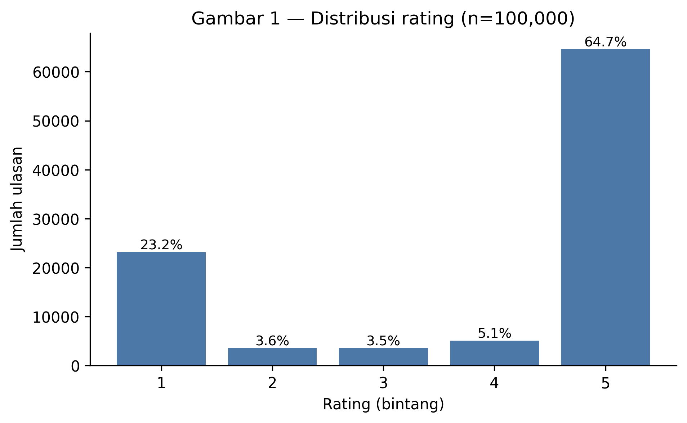

Dua ujung skala menguasai 87,9% data, sementara tiga bintang tengah hanya 12,2%.
<!-- src: facts.yaml distribusi_rating.pct_ekstrem_1_dan_5 dan pct_tengah_2_3_4 -->
Bentuk ini lazim pada ulasan toko aplikasi: pengguna menulis ketika sangat puas
atau sangat kecewa.

**Panjang teks berkorelasi terbalik dengan rating — dan sangat tajam.**

| Rating | Rata-rata kata | Median kata |
|--------|----------------|-------------|
| 1 bintang | 20,8 | 15 |
| 2 bintang | 22,4 | 17 |
| 3 bintang | 20,0 | 15 |
| 4 bintang | 10,0 | 4 |
| 5 bintang | 4,4 | 2 |

<!-- src: docs/tables/panjang_per_rating.csv -->

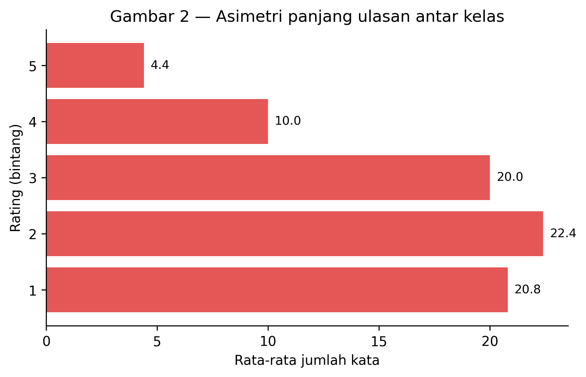

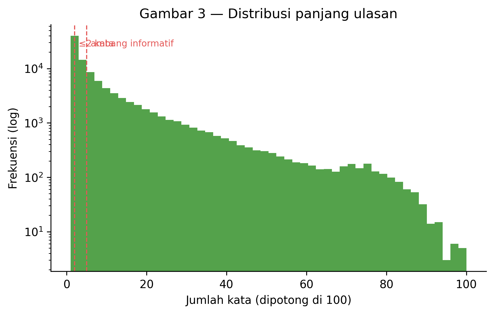

Ulasan bintang lima rata-rata **4,4 kata**, dengan median **2 kata**. Ulasan
bintang satu lima kali lebih panjang. Konsekuensinya langsung terlihat pada
komposisi korpus: **39.859 ulasan (39,9%) hanya berisi dua kata atau kurang**,
sementara yang berisi minimal lima kata hanya 45.685 (45,7%).
<!-- src: docs/tables/ulasan_pendek.csv -->

**Korpus positif jauh lebih berulang daripada korpus negatif.**

| Properti | Kelas negatif | Kelas positif |
|----------|---------------|---------------|
| Jumlah ulasan | 26.732 | 69.734 |
| Duplikat teks | 546 (2,0%) | 31.214 (44,8%) |
| Ulasan ≤2 kata | 6,0% | 54,4% |

<!-- src: docs/tables/kontras_kelas.csv -->

Secara keseluruhan 32.101 ulasan (32,1%) adalah duplikat teks, sementara duplikat
baris penuh nol. Teks yang paling sering berulang adalah "Mantap" — 2.063
kemunculan.
<!-- src: docs/tables/duplikasi.csv; docs/tables/teks_paling_berulang.csv -->

**Volume dan metadata lain.** Volume bulanan tertinggi terjadi pada Juli 2024
(6.641 ulasan) dan terendah pada Agustus 2025 (3.620), dengan rata-rata rating
turun dari 3,93 pada bulan penuh pertama menjadi 3,57 pada bulan terakhir.
<!-- src: docs/tables/volume_bulanan.csv --> Kolom `Likes` sangat terpusat: 83,7%
ulasan tidak pernah memperoleh satu pun *like*, sementara nilai tertingginya
2.904. <!-- src: docs/tables/profil_likes.csv --> Terdapat 291 versi aplikasi
unik; analisis per-versi dibatasi pada 66 versi dengan minimal 100 ulasan, yang
mencakup 96,4% data berversi.
<!-- src: docs/tables/cakupan_versi.csv -->

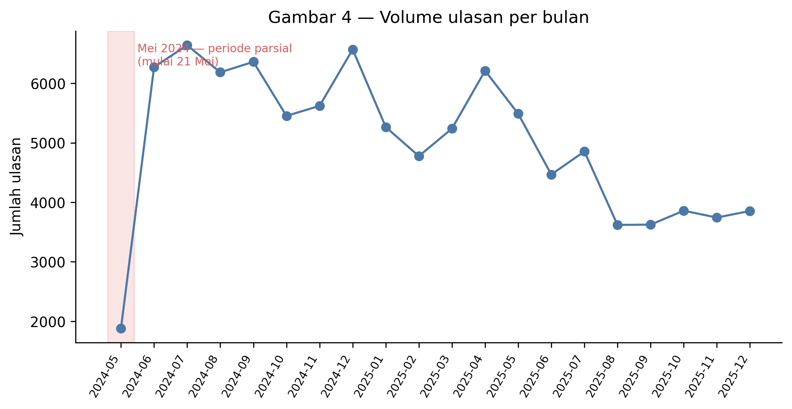

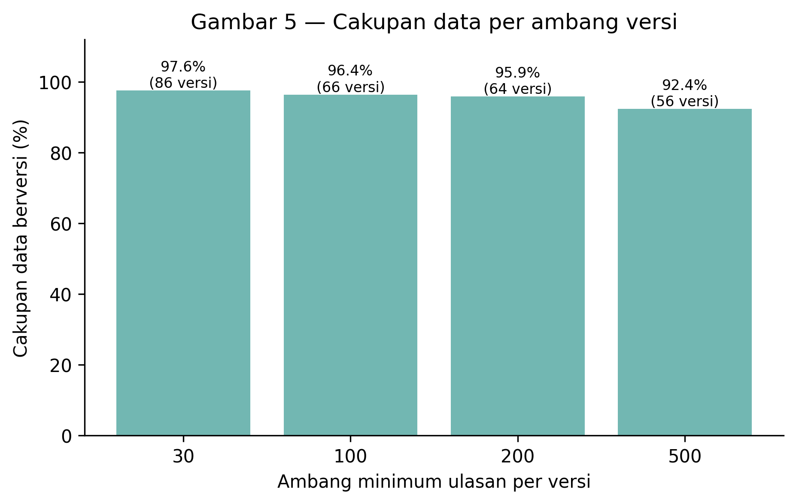

<!-- ===== §4.2 Perbandingan model — SIAP TEMPEL ===== -->

### 4.2 Perbandingan model

Keempat varian dilaporkan setelah tuning, pada kedua set evaluasi. Baseline kelas
mayoritas disertakan sebagai lantai pembanding.

| Model | macro-F1 `full` | macro-F1 `informative` | recall neg `full` | presisi neg `full` | akurasi `full` | latih (detik) |
|-------|-----------------|------------------------|-------------------|--------------------|----------------|---------------|
| LinearSVC | **0,9341** | 0,9066 | 0,9370 | 0,8769 | 0,9461 | 1,44 |
| LogisticRegression | 0,9338 | **0,9071** | 0,9267 | **0,8845** | 0,9461 | 1,57 |
| MultinomialNB | 0,9296 | 0,9016 | 0,9428 | 0,8610 | 0,9420 | 1,22 |
| ComplementNB | 0,9153 | 0,8987 | **0,9553** | 0,8182 | 0,9288 | 1,19 |
| *Baseline mayoritas* | *0,4196* | *0,3173* | *0,0000* | *0,0000* | *0,7229* | — |

<!-- src: docs/tables/model_metrics.csv baris *_tuned dan majority_baseline -->

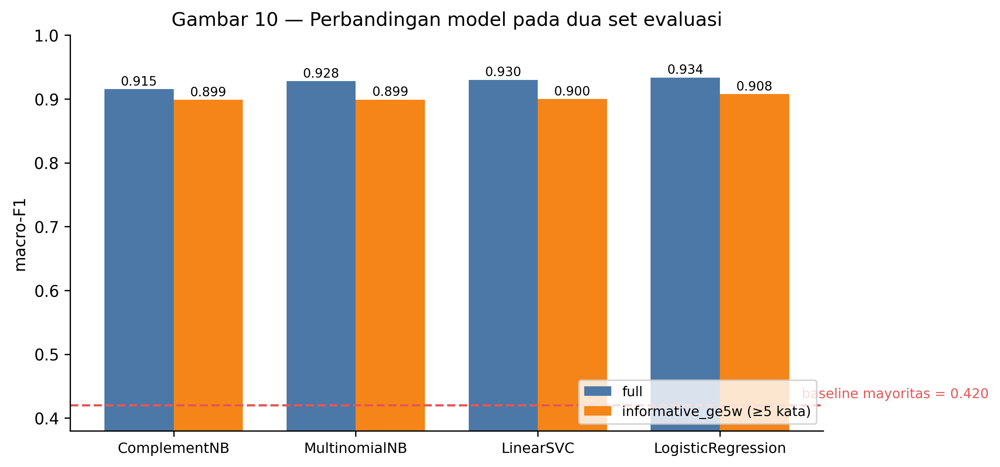

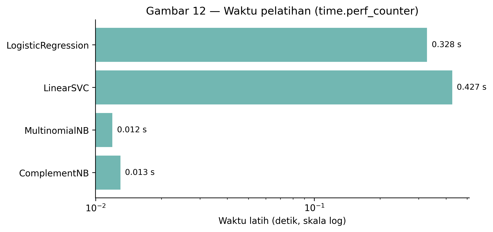

Tiga hal yang terbaca dari tabel ini:

**(a) Seluruh model mengalahkan baseline dengan selisih besar.** Model produksi
unggul 51,41 poin macro-F1 atas baseline kelas mayoritas.
<!-- src: facts.yaml model.produksi.unggul_baseline_poin -->

**(b) Perbedaan antar-model kecil.** Rentang macro-F1 `full` keempat varian hanya
**1,88 poin** (0,9153–0,9341). Selisih antara LinearSVC dan LogisticRegression —
0,03 poin — setara sekitar enam baris dari 19.294.
<!-- src: facts.yaml model.rentang_macro_f1_tuned -->

**(c) Model yang unggul berbeda tergantung metrik.** LinearSVC tertinggi pada
macro-F1 `full`; LogisticRegression tertinggi pada macro-F1 `informative` dan
presisi negatif; ComplementNB tertinggi pada recall negatif di kedua set, dengan
biaya presisi terendah. Tidak ada satu model yang menang pada semua kolom.

**Model produksi.** Yang ditetapkan sebagai model produksi adalah
**LogisticRegression** dengan `C=1.0, class_weight="balanced"`, karena syarat
"LinearSVC unggul ≥2 poin" tidak terpenuhi sehingga berlaku ketentuan memilih
model yang lebih sederhana dan lebih mudah dijelaskan. Empat alasannya: ia
menyediakan `predict_proba` bawaan sehingga tidak memerlukan lapisan kalibrasi;
ia unggul justru pada set evaluasi yang lebih sulit; presisi negatifnya
tertinggi; dan koefisiennya dapat ditampilkan langsung sebagai log-odds per kata.
<!-- src: docs/model_decision.md §5 -->

Metrik lengkap model produksi:

| Metrik | `full` (n=19.294) | `informative_ge5w` (n=8.696) |
|--------|-------------------|------------------------------|
| macro-F1 | 0,9336 | 0,9078 |
| Akurasi | 0,9459 | 0,9089 |
| Recall negatif | 0,9315 | 0,9536 |
| Presisi negatif | 0,8802 | 0,8851 |
| F1 negatif | 0,9051 | 0,9181 |
| Recall positif | 0,9514 | — |

<!-- src: docs/tables/model_metrics.csv baris logistic_regression_final; ml/artifacts/reports/logistic_regression_final_full.json -->

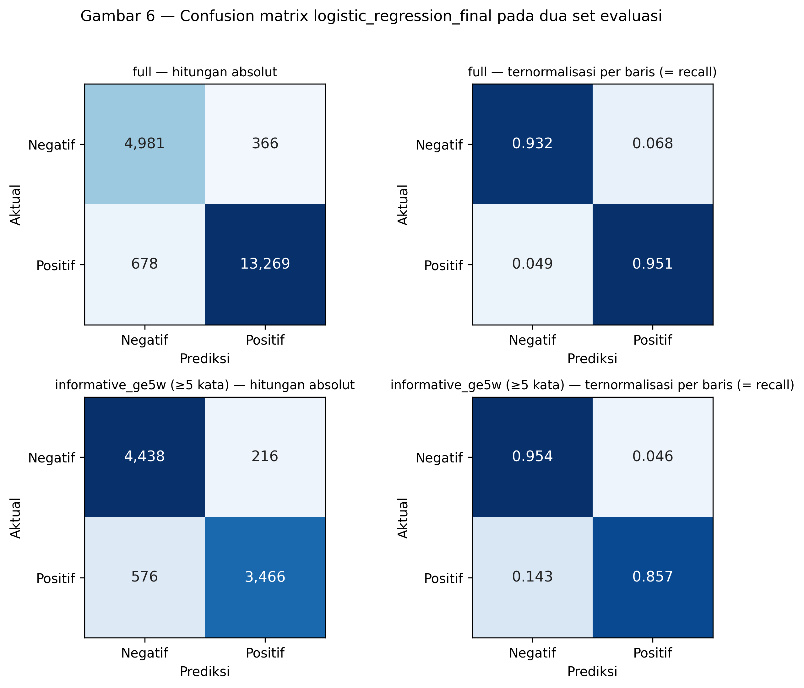

<!-- ===== §4.3 Hasil tuning — SIAP TEMPEL ===== -->

### 4.3 Hasil tuning

`GridSearchCV` dijalankan dengan `scoring="f1_macro"` — bukan akurasi, karena
baseline sudah memperoleh 0,7229 akurasi tanpa mempelajari apa pun — memakai
`StratifiedKFold` 5 lipatan atas 45.614 baris latih. Total 24 kombinasi dan 120
*fit*, selesai dalam 39,8 detik. Vectorizer berada **di dalam** `Pipeline`,
sehingga TF-IDF di-*fit* ulang pada 4/5 data di setiap lipatan dan tidak ada
kebocoran kosakata dari lipatan validasi.
<!-- src: docs/tables/gridsearch_results.csv; ml/artifacts/best_params.json -->

**Temuan utama tuning: kurva regularisasi LinearSVC.** Kolom skor *training*
menjelaskan mengapa model ini naik setelah tuning. Pada `C=5,0` model mencapai
macro-F1 0,9932 di data latih tetapi hanya 0,8879 di validasi silang — selisih
0,1052. Parameter terpilih `C=0,1` menekan selisih itu menjadi 0,0226 dengan skor
validasi 0,9099, yaitu regularisasi sepuluh kali lebih kuat dari nilai bawaan
Fase 3.
<!-- src: docs/tables/gridsearch_results.csv -->

Ini layak dibahas: pada TF-IDF 30.000 fitur dengan 45.614 dokumen, jumlah fitur
mendekati jumlah contoh per kelas, sehingga model linear dengan regularisasi
lemah dapat memisahkan data latih hampir sempurna tanpa mempelajari pola yang
berlaku umum.

**Aturan satu simpangan baku.** Untuk LogisticRegression, `GridSearchCV` memilih
`C=5,0` dengan skor validasi 0,908486 — unggul hanya **0,00015** dari `C=1,0`
(0,908341), yaitu dua puluh kali lebih kecil daripada simpangan bakunya sendiri
(0,003017). Sebagai gantinya, `C=5,0` menanggung selisih latih−uji lebih dari dua
kali lipat (0,0499 berbanding 0,0221). Aturan satu simpangan baku memilih
konfigurasi paling sederhana yang skornya masih berada dalam satu simpangan baku
dari yang terbaik, dan di sini itu berarti `C=1,0`.
<!-- src: docs/tables/gridsearch_results.csv; ml/artifacts/best_params.json -->

Aturan yang sama diterapkan pada keempat model: ia mengubah pilihan pada tiga
model dan **mengonfirmasi** pilihan grid pada LinearSVC — yang berarti ia bukan
mekanisme yang selalu menggeser hasil.
<!-- src: ml/artifacts/best_params.json kunci seleksi_1se -->

Konsekuensi yang paling layak dilaporkan: `C=1,0, class_weight="balanced"` adalah
persis konfigurasi bawaan yang dipakai sebelum tuning. Untuk LogisticRegression,
seluruh proses tuning berakhir kembali di titik awalnya — bukan karena tuning
gagal dijalankan, melainkan karena pada TF-IDF dengan data sebesar ini
*hyperparameter* bukan faktor penentu kinerja.

<!-- ===== §4.4 Topik keluhan — SIAP TEMPEL ===== -->

### 4.4 Topik keluhan

**Frekuensi n-gram lebih dulu.** Sebelum LDA dijalankan, analisis n-gram atas
korpus negatif sudah menunjuk arah yang jelas: kata `tidak` muncul di 59,0%
dokumen dan `pengemudi` di 38,0%, sementara bigram `dapat pengemudi` muncul di
8,8% dokumen.
<!-- src: docs/tables/ngram_negatif.csv -->

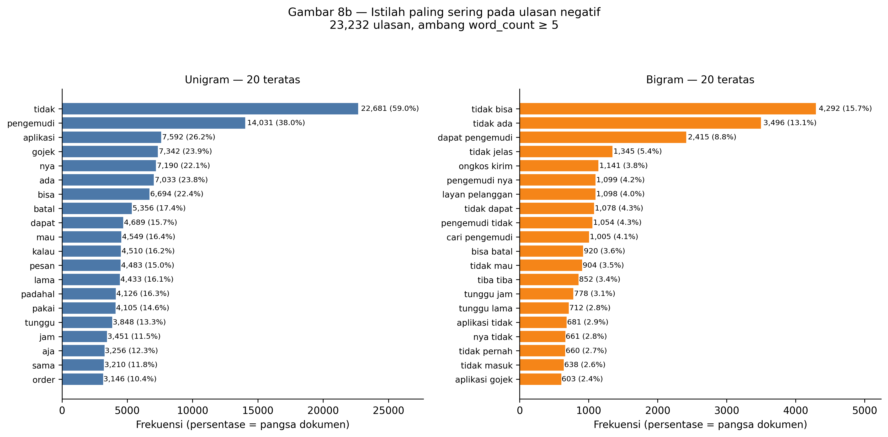

Kedua angka itu sendiri sudah merupakan temuan: keluhan pada aplikasi ini dominan
berbentuk **ketiadaan layanan**, dan berpusat pada mitra driver.

**Pemilihan jumlah topik.** Koherensi `c_v` dipindai pada k=5 sampai k=12 dan
tertinggi pada **k=9** dengan nilai 0,5763.
<!-- src: docs/tables/lda_coherence.csv -->

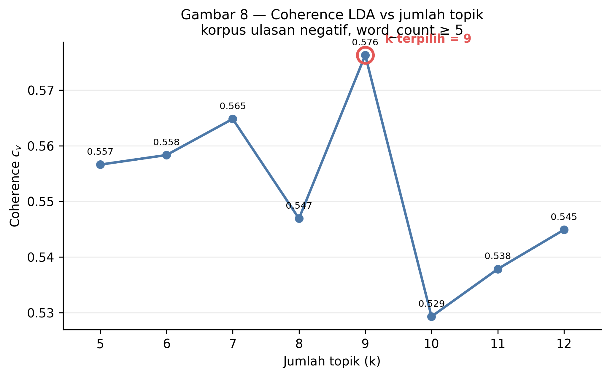

**Peringkat sembilan kategori keluhan.** Dua kolom dilaporkan terpisah dan tidak
digabung menjadi skor komposit: frekuensi mengukur berapa banyak yang mengeluh,
rata-rata *likes* mengukur berapa banyak yang merasakan hal yang sama.

| # | Kategori | Ulasan | % negatif | Total likes | Rata likes | Peringkat likes |
|---|----------|--------|-----------|-------------|------------|-----------------|
| 1 | Ketersediaan & Respons Mitra Driver | 9.663 | 36,15% | 25.913 | 2,68 | 2 |
| 2 | Pesanan GoFood & Pembatalan | 9.155 | 34,25% | 27.805 | 3,04 | 1 |
| 3 | Tarif, Ongkir & Promo | 6.939 | 25,96% | 17.754 | 2,56 | 4 |
| 4 | Layanan Pelanggan & Penanganan Keluhan | 6.916 | 25,87% | 20.941 | 3,03 | 3 |
| 5 | Transaksi & Saldo GoPay | 4.874 | 18,23% | 11.869 | 2,44 | 8 |
| 6 | GoPayLater, GoPinjam & Penagihan | 4.786 | 17,90% | 12.657 | 2,65 | 6 |
| 7 | Performa & Gangguan Aplikasi | 4.479 | 16,76% | 15.321 | 3,42 | 5 |
| 8 | Akurasi Lokasi & Rute | 3.138 | 11,74% | 12.086 | 3,85 | 7 |
| 9 | Akun, Login & Verifikasi | 3.048 | 11,40% | 8.037 | 2,64 | 9 |

<!-- src: docs/tables/topics_ranked.csv -->

*Persentase dihitung terhadap 26.732 ulasan negatif. Kategori tidak saling
eksklusif, sehingga totalnya melebihi 100%. Seluruh penetapan berjumlah 52.998
pasangan (ulasan, kategori).*

<!-- src: docs/tables/topics_ranked.csv -->

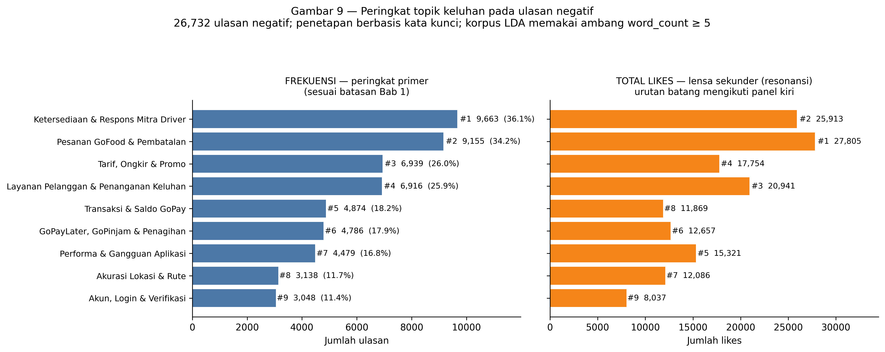

**Peringkat frekuensi tidak sama dengan peringkat resonansi.** Tiga kategori
berpindah posisi ketika diurutkan berdasarkan rata-rata *likes*:

- **Transaksi & Saldo GoPay** turun dari peringkat 5 ke peringkat 9 (rata-rata
  *likes* 2,44, terendah). Kegagalan transaksi bersifat personal — pembaca lain
  tidak mengalaminya, sehingga tidak ikut menekan tombol *like*.
- **Akurasi Lokasi & Rute** memiliki rata-rata *likes* tertinggi (3,85) meski
  frekuensinya peringkat 8. Keluhan titik jemput yang salah segera dikenali
  banyak orang.
- **Performa & Gangguan Aplikasi** naik dari peringkat 7 ke 5 (rata-rata 3,42):
  gangguan aplikasi dialami serentak.

**Tren bulanan.** Puncak tertinggi satu kategori dalam satu bulan terjadi pada
April 2025 untuk Pesanan GoFood & Pembatalan (833 ulasan). Sepanjang periode
pengamatan, kategori Tarif, Ongkir & Promo menurun konsisten dari 572 ulasan pada
Desember 2024 menjadi 259 pada Desember 2025 — turun 54,7%.
<!-- src: docs/tables/topic_trend_monthly.csv -->

**Validasi silang pelabelan.** 50 ulasan negatif dilabeli secara independen tanpa
melihat keluaran pipeline, lalu dibandingkan dengan hasil penetapan otomatis:

| Metrik | Nilai |
|--------|-------|
| Cohen's κ | 0,4621 |
| Kesepakatan longgar (kategori penilai ada di dalam himpunan otomatis) | 84,0% |
| Kesepakatan ketat (kecocokan label tunggal) | 52,0% |
| Jaccard rerata | 0,4967 |

<!-- src: docs/tables/h9_hasil_kesepakatan.csv -->

Angka κ 0,4621 berada pada tingkat *moderate*, bukan *substantial*, dan
dilaporkan apa adanya. Kata kunci pemetaan **tidak** diperbaiki setelah melihat
hasil validasi, karena memperbaikinya akan membatalkan angka itu sebagai validasi
independen. Konsekuensinya bagi pembacaan §4.4 dinyatakan di §6.

---

<!-- ===== §5 Pembahasan — SIAP TEMPEL ===== -->

## 5. Pembahasan

<!-- ===== §5.1 Temuan metodologis: asimetri panjang — SIAP TEMPEL ===== -->

### 5.1 Temuan metodologis: asimetri panjang teks membuat akurasi menipu

Ini temuan terpenting laporan ini, dan argumennya berjalan dalam lima langkah.

**Langkah 1 — Fakta.** Panjang ulasan berkorelasi terbalik dengan rating, dan
korelasinya ekstrem. Ulasan bintang lima rata-rata **4,4 kata** dengan median
**2 kata**; ulasan bintang satu rata-rata **20,8 kata**. Akibatnya **39.859
ulasan (39,9%)** hanya berisi dua kata atau kurang, dan 54,4% kelas positif
berada di kelompok itu berbanding 6,0% pada kelas negatif.
<!-- src: docs/tables/panjang_per_rating.csv; docs/tables/ulasan_pendek.csv; docs/tables/kontras_kelas.csv -->

**Langkah 2 — Konsekuensi teoretis.** Pada representasi TF-IDF, kondisi itu
menciptakan jalan pintas. Model tidak perlu mempelajari sentimen untuk
mengklasifikasikan hampir separuh korpus dengan benar; ia cukup mempelajari bahwa
dokumen yang hanya berisi `mantap`, `bagus`, atau `ok` adalah positif. Korelasi
itu trivial dan tidak berpindah ke teks yang lebih panjang. Bukti bahwa jalan
pintas itu memang tersedia: teks "Mantap" saja berulang 2.063 kali, dan 44,8%
kelas positif adalah duplikat teks berbanding 2,0% pada kelas negatif.
<!-- src: docs/tables/teks_paling_berulang.csv; docs/tables/kontras_kelas.csv -->

**Langkah 3 — Bukti.** Karena itu setiap model dievaluasi dua kali. Selisihnya
konsisten pada keempat varian, dan pada model produksi berukuran:

| Set evaluasi | n | macro-F1 | Akurasi | Recall negatif |
|--------------|---|----------|---------|----------------|
| `full` | 19.294 | 0,9336 | 0,9459 | 0,9315 |
| `informative_ge5w` | 8.696 | 0,9078 | 0,9089 | 0,9536 |
| **Selisih** | — | **−2,59 poin** | **−3,70 poin** | **+2,20 poin** |

<!-- src: docs/tables/model_metrics.csv; facts.yaml model.produksi -->

Arah selisihnya sendiri informatif. macro-F1 dan akurasi **turun** pada teks yang
lebih panjang, sementara recall negatif justru **naik** 2,20 poin. Artinya yang
hilang bukan kemampuan mengenali keluhan, melainkan kemudahan yang selama ini
disediakan oleh ribuan pujian dua kata.

**Langkah 4 — Implikasi.** Akurasi tinggi pada dataset ulasan aplikasi sering
merupakan artefak distribusi panjang teks, bukan bukti pemahaman sentimen. Pada
korpus ini, 3,70 poin akurasi yang menguap ketika ulasan sangat pendek
<!-- src: facts.yaml model.produksi.selisih_accuracy_poin -->
dikeluarkan bukan angka kecil: ia setara dengan lebih dari separuh jarak antara
model produksi dan akurasi sempurna. Laporan yang hanya menyebut satu angka
akurasi memberi gambaran yang terlalu optimistis atas kemampuan sistemnya
sendiri.

**Langkah 5 — Rekomendasi metodologis.** Penelitian sejenis pada korpus ulasan
toko aplikasi sebaiknya: (a) melaporkan distribusi panjang teks per kelas sebagai
bagian dari statistik deskriptif, bukan sebagai catatan kaki; (b) mendefinisikan
satu subset "informatif" dengan ambang panjang yang dinyatakan terbuka dan
melaporkan metrik pada kedua set; dan (c) memperlakukan selisih antar-set sebagai
besaran yang dilaporkan, bukan sebagai hal yang perlu diperkecil. Selisih yang
besar bukan kelemahan penelitian — ia karakteristik data yang baru terlihat
ketika diukur.

<!-- ===== §5.2 Analisis kesalahan — SIAP TEMPEL ===== -->

### 5.2 Analisis kesalahan: separuh "kesalahan" bukan kesalahan model

Sebanyak 1.040 kesalahan (5,39% dari 19.294 baris uji) diperiksa secara statistik,
dan 50 di antaranya dibaca satu per satu oleh manusia yang mengisi kategori
penyebabnya.
<!-- src: docs/error_analysis.md §2; docs/tables/error_analysis_50_reviewed.csv -->

| Kategori penyebab | n | % |
|-------------------|---|---|
| Label keliru dari pengguna | 24 | 48,0% |
| Negasi kompleks | 10 | 20,0% |
| Kegagalan preprocessing | 8 | 16,0% |
| Terlalu pendek / ambigu | 3 | 6,0% |
| Sarkasme / ironi | 2 | 4,0% |
| Topik netral / di luar topik | 2 | 4,0% |
| Campur kode | 1 | 2,0% |

<!-- src: docs/tables/error_analysis_50_reviewed.csv -->

**Temuan utama: 48,0% kesalahan adalah label yang keliru dari pengguna** —
bintang yang bertentangan dengan isi tulisannya. Arahnya sangat timpang: dari 34
alarm palsu dalam sampel, 22 (64,7%) sebenarnya berisi keluhan yang diberi
bintang 4–5 oleh penulisnya; sedangkan dari 16 keluhan yang lolos, hanya 2
(12,5%) yang berlabel keliru. Dengan kata lain, ketika model menandai ulasan
berbintang tinggi sebagai negatif, dua pertiga waktu **modelnya yang benar**.

**Bukti silang yang tidak dirancang sebelumnya.** Keyakinan model dicatat bersama
kategori penyebab. Dari 22 kesalahan berkeyakinan tinggi, 16 (72,7%) adalah label
keliru; sebaliknya, kesalahan yang benar-benar sulit — negasi kompleks dan
kegagalan preprocessing — hampir seluruhnya terjadi di dekat batas keputusan,
yaitu ketika model memang ragu (28 dari 50 kesalahan).
<!-- src: docs/error_analysis.md §3.2 -->

Ketika model yakin dan "salah", umumnya modelnya yang benar dan bintangnya yang
keliru. Pola ini tidak dapat dilihat dari metrik agregat mana pun.

**Konsekuensi: plafon kinerja pada dataset ini bukan 1,0000.** Bila 48,0% dari
1.040 kesalahan adalah label keliru, maka sekitar **499 baris (2,59%)** dari
19.294 baris uji membawa bintang yang bertentangan dengan teksnya, sehingga
plafon akurasi realistis **≈0,9741**. Akurasi model produksi 0,9459 karena itu
setara **97,1% dari plafon**, dan sisa ruang perbaikan bukan 5,4 poin melainkan
≈2,82 poin.
<!-- src: docs/error_analysis.md §3.3; facts.yaml analisis_kesalahan -->

Tiga kualifikasi wajib menyertai angka itu dan tidak boleh dihilangkan:
estimasinya berasal dari sampel 50 baris sehingga selang kepercayaannya lebar;
sampel diambil hanya dari baris yang salah diklasifikasikan, sehingga 2,59%
adalah **batas bawah** derau label; dan penilaian "label keliru" adalah penilaian
manusia yang pada beberapa kasus berbatasan dengan kategori polaritas campuran.

**Yang diperkirakan besar tetapi ternyata kecil: sarkasme.** Literatur analisis
sentimen umumnya menempatkan sarkasme sebagai penyebab utama kesalahan. Pada
sampel ini sarkasme hanya 2 dari 50 kasus (4,0%) dan campur kode 1 kasus (2,0%).
<!-- src: docs/tables/error_analysis_50_reviewed.csv -->
Yang dominan justru dua hal yang jarang dibahas: derau label dari pengguna
(48,0%) dan polaritas campuran dalam satu ulasan (20,0%). Pada ulasan aplikasi
berbahasa Indonesia, pola "bagus tapi…" jauh lebih sering menjadi sumber
kesalahan daripada ironi.

<!-- ===== §5.3 Interpretasi fitur — SIAP TEMPEL ===== -->

### 5.3 Interpretasi fitur

Koefisien LogisticRegression adalah log-odds per kata, sehingga 20 fitur
berbobot tertinggi per kelas dapat dibaca langsung.
<!-- src: docs/tables/top_features.csv -->

| Kelas | 10 fitur teratas |
|-------|------------------|
| Negatif | tidak, buruk, jelek, tolol, parah, batal, sampah, tidak ramah, iklan, malah |
| Positif | bagus, mantap, mudah, bantu, sangat bantu, keren, tidak ribet, oke, terbaik, cepat |

Tiga hal yang perlu dicatat:

**(a) Bigram negasi bertahan sebagai fitur bermakna.** `tidak ramah` muncul di
daftar negatif, dan `tidak ribet` serta `tidak kecewa` di daftar positif. Ini
verifikasi langsung atas keputusan preprocessing di §3.2: bila kata `tidak`
dibuang sebagai *stopword*, ketiganya akan kehilangan polaritasnya, dan dua di
antaranya akan berbalik arah.

**(b) Fitur negatif bercampur antara keluhan produk dan luapan emosi.** `batal`
dan `iklan` adalah istilah domain yang menunjuk masalah nyata; `tolol` dan
`sampah` adalah penanda emosi yang tidak menunjuk apa pun secara spesifik.
Keduanya sah sebagai sinyal klasifikasi, tetapi hanya kelompok pertama yang
berguna untuk triase keluhan — dan itulah sebabnya ekstraksi topik (§4.4)
dikerjakan terpisah dari klasifikasi, bukan diturunkan dari koefisiennya.

**(c) Tidak ada artefak preprocessing yang lolos ke daftar teratas.** Pertanyaan
"apakah ini istilah domain atau artefak preprocessing?" dijawab untuk setiap
fitur pada kedua kelas, dan tidak ada potongan kata hasil *stemming* yang keliru
maupun token sisa normalisasi yang muncul. Ini kriteria yang ditetapkan lebih
dulu sebagai pemicu iterasi kembali ke preprocessing; kriterianya tidak
terpenuhi, sehingga iterasi tidak dijalankan.
<!-- src: docs/preprocessing_validation.md §6 -->

<!-- ===== §5.4 Kegagalan skema 3 kelas — SIAP TEMPEL ===== -->

### 5.4 Kegagalan skema tiga kelas sebagai temuan

Keputusan membuang rating 3 bintang hanya dapat dipertahankan bila ada bukti
kuantitatif. Karena itu skema yang dibuang tetap dijalankan satu kali dengan
protokol identik — TF-IDF yang sama, pembagian data yang sama, LinearSVC dengan
parameter hasil tuning biner — dan hasilnya dilaporkan apa adanya.

| Metrik | Biner (LinearSVC) | Tiga kelas | Selisih |
|--------|-------------------|------------|---------|
| macro-F1 | 0,9341 | **0,6470** | **−28,7 poin** |
| Recall negatif | 0,9370 | 0,8949 | −4,2 poin |
| Recall positif | — | 0,9449 | — |
| **Recall netral** | — | **0,1103** | — |

<!-- src: ml/artifacts/reports/three_class_linear_svc.json; docs/three_class_experiment.md §2 -->

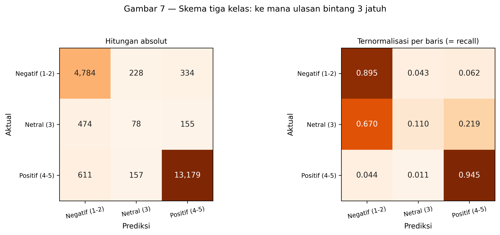

Dari 707 ulasan bintang 3 di test set, model mengenali 78 (11,0%). Sisanya jatuh
ke kelas lain, dan tidak merata: **474 (67,0%) menjadi negatif** dan 155 (21,9%)
menjadi positif — tiga kali lebih sering ke arah negatif.
<!-- src: ml/artifacts/reports/three_class_linear_svc.json -->

Perhatikan bahwa recall negatif dan positif hampir tidak berubah. Kegagalannya
terkonsentrasi seluruhnya pada kelas ketiga, dan macro-F1 turun 28,7 poin karena
rata-rata makro memberi bobot sama kepada kelas yang gagal total itu. Akurasi
skema tiga kelas tetap 0,9021 — bila yang dilaporkan hanya akurasi, kegagalan ini
tidak akan terlihat sama sekali. Ini argumen tersendiri untuk pemilihan metrik di
§3.5.

**Penyebabnya bukan *hyperparameter*, melainkan dua sifat data yang terukur:**

*(a) Ketimpangan 1:19,7.* Kelas netral hanya 707 baris uji dan 2.595 baris latih.
<!-- src: ml/artifacts/reports/three_class_linear_svc.json -->
`class_weight="balanced"` sudah aktif dan tetap tidak cukup — pembobotan dapat
mengoreksi *prior*, tetapi tidak dapat menciptakan sinyal leksikal yang tidak
ada.

*(b) Kemiripan panjang teks dengan kelas negatif.* Ini inti persoalannya:

| Kelas | Rata-rata kata |
|-------|----------------|
| Negatif (1–2 bintang) | 21,46 |
| Netral (3 bintang) | 19,76 |
| Positif (4–5 bintang) | 4,94 |

<!-- src: ml/artifacts/reports/three_class_linear_svc.json -->

Ulasan netral praktis tidak terbedakan dari ulasan negatif, sementara ulasan
positif hanya seperempat panjangnya. Pada representasi *bag-of-words*, panjang
teks berkorelasi langsung dengan jumlah token bukan-nol, sehingga ulasan netral
menghasilkan vektor yang menyerupai vektor kelas negatif. Secara isi hal ini
masuk akal: pengguna yang memberi tiga bintang umumnya menulis keluhan disertai
pengakuan, dan kosakata keluhannya sama dengan kosakata pengguna bintang 1–2.
Yang membedakan keduanya adalah derajat, bukan kata — dan derajat tidak terwakili
dalam TF-IDF.

Membuang rating 3 bintang karena itu bukan penyederhanaan demi angka yang bagus;
ia pengakuan bahwa label bintang 3 pada data ini tidak membawa sinyal yang cukup
untuk dipelajari sebagai kelas tersendiri. Biayanya dinyatakan sebagai
keterbatasan di §6.

<!-- ===== §5.5 Implikasi bisnis — SIAP TEMPEL ===== -->

### 5.5 Implikasi bisnis

**Prioritas perbaikan berdasarkan volume.** Dua kategori teratas — Ketersediaan &
Respons Mitra Driver (36,15% ulasan negatif) dan Pesanan GoFood & Pembatalan
(34,25%) — bersama-sama menyentuh 70,4% korpus keluhan. Keduanya terpaut tipis
(9.663 berbanding 9.155 ulasan), sehingga memperlakukan salah satunya sebagai
"masalah nomor satu" tidak didukung data; keduanya satu kelompok prioritas.
<!-- src: docs/tables/topics_ranked.csv -->

**Prioritas berdasarkan resonansi berbeda dari prioritas berdasarkan volume.**
Perbedaan antara kedua peringkat itu sendiri sebuah temuan operasional: masalah
saldo GoPay banyak dilaporkan (peringkat 5) tetapi paling sedikit diamini pengguna
lain (peringkat 9 berdasarkan rata-rata *likes* 2,44), sementara gangguan
aplikasi (rata-rata 3,42) dan akurasi lokasi (3,85) beresonansi jauh lebih luas
daripada frekuensinya. Bila kapasitas perbaikan terbatas, kedua kolom itu menjawab
pertanyaan yang berbeda — berapa banyak yang mengeluh, dan berapa banyak yang
merasakan hal yang sama — dan karena itu tidak boleh digabung menjadi satu skor.
<!-- src: docs/tables/topics_ranked.csv -->

**Tanda perbaikan yang terukur.** Kategori Tarif, Ongkir & Promo turun konsisten
dari 572 ulasan pada Desember 2024 menjadi 259 pada Desember 2025 (−54,7%),
sementara dua kategori teratas tidak menunjukkan penurunan sebanding. Ini pola
yang layak ditelusuri: apakah penurunannya berasal dari perubahan kebijakan
tarif, atau dari pergeseran komposisi pengguna yang menulis ulasan.
<!-- src: docs/tables/topic_trend_monthly.csv -->

**Triase otomatis layak dipakai, dengan syarat yang jelas.** Pada test set, model
produksi menangkap 93,15% ulasan negatif dengan presisi 88,02%. Untuk alur kerja
triase — menyaring ulasan yang perlu dibaca manusia — komposisi kesalahannya
menguntungkan: dua pertiga alarm palsu pada sampel manual ternyata berisi keluhan
nyata yang diberi bintang tinggi (§5.2), sehingga sebagian besar "gangguan" yang
ditimbulkan sistem justru temuan yang diinginkan.
<!-- src: docs/tables/model_metrics.csv; docs/error_analysis.md §3.1 -->

**Yang tidak boleh diklaim.** Sistem ini tidak mengukur kepuasan pelanggan, tidak
memprediksi *churn*, dan tidak mewakili seluruh pengguna aplikasi — hanya mereka
yang menulis ulasan. Seluruh angka di atas berlaku atas korpus 100.000 ulasan
periode 21 Mei 2024 – 31 Desember 2025, bukan atas populasi pengguna.

---

<!-- ===== §6 Keterbatasan — SIAP TEMPEL ===== -->

## 6. Keterbatasan

Tujuh keterbatasan berikut menyatakan **apa** batasnya, **seberapa besar**, dan
**apa konsekuensinya** bagi penafsiran hasil.

**(1) Label diturunkan dari rating bintang, bukan anotasi manusia.** Pemeriksaan
manual menunjukkan 48,0% kesalahan model adalah label yang keliru dari pengguna,
sehingga plafon akurasi realistis pada dataset ini ≈0,9741, bukan 1,0000.
Sebagian "kesalahan" model sebenarnya prediksi yang benar atas label yang salah.
<!-- src: docs/limitations.md §1 -->

**(2) 39,9% ulasan hanya berisi ≤2 kata, sehingga metrik pada test set penuh
optimistis.** Ukurannya adalah selisih 2,59 poin macro-F1 dan 3,70 poin akurasi
antara kedua set evaluasi. Setiap klaim kinerja dalam laporan ini harus dibaca
berpasangan, bukan hanya angka `full`-nya.
<!-- src: docs/limitations.md §2 -->

**(3) Kelas netral dikeluarkan dari model utama.** 3.534 ulasan (3,5%) tidak
tercakup model produksi, yang berarti ulasan bernada campuran akan dipaksa masuk
salah satu dari dua kelas. Eksperimen §5.4 menunjukkan sebagian besar akan
diarahkan ke negatif — untuk triase keluhan arah bias itu kebetulan aman, tetapi
ia tetap bias dan harus disebut sebagai bias.
<!-- src: docs/limitations.md §3 -->

**(4) 21,9% ulasan tidak mencantumkan versi aplikasi** dan tidak diimputasi.
Analisis per-versi karena itu berlaku atas 75.247 ulasan, bukan atas 100.000, dan
seperlima data tak berversi mungkin tidak acak — hal yang tidak dapat diuji dari
data yang tersedia.
<!-- src: docs/limitations.md §4 -->

**(5) Pelabelan kategori topik bersifat manual dan subjektif.** Cohen's κ 0,4621
berada pada tingkat *moderate*. Konsekuensinya, peringkat kategori harus dibaca
sebagai indikasi arah, bukan pengukuran presisi: selisih kecil seperti antara
peringkat 3 dan 4 (6.939 berbanding 6.916 ulasan) berada di dalam derau
pelabelan.
<!-- src: docs/limitations.md §5 -->

**(6) Data statis satu periode, dari sumber sekunder.** Korpus mencakup 20 bulan
dengan pembagian acak berstratifikasi, bukan pembagian temporal, sehingga tidak
ada bukti bagaimana kinerja model bertahan terhadap perubahan kosakata pengguna
atau pergeseran pola keluhan. Selain itu, karena dataset berasal dari unggahan
pihak ketiga, metode pengambilan datanya tidak terdokumentasi dan tidak dapat
diverifikasi.
<!-- src: docs/limitations.md §6; docs/data_provenance_notes.md -->

**(7) Sistem tidak di-*deploy* ke produksi.** Lingkupnya prototipe lokal: tiga
*container* pada satu mesin, tanpa autentikasi, pemantauan, atau strategi
pelatihan ulang. Skoring bersifat *batch* sekali jalan. Setiap klaim tentang
kesiapan operasional berada di luar yang dibuktikan penelitian ini.
<!-- src: docs/limitations.md §7 -->

---

<!-- ===== §7 Kesimpulan & Saran — SIAP TEMPEL ===== -->

## 7. Kesimpulan dan Saran

### 7.1 Jawaban atas RM1

Pada korpus 100.000 ulasan Gojek berbahasa Indonesia, **tidak ada satu keluarga
algoritma yang unggul secara berarti atas yang lain.** Empat varian dari tiga
keluarga — ComplementNB, MultinomialNB, LinearSVC, dan LogisticRegression —
dilatih dengan representasi TF-IDF dan pembagian data yang identik, dan rentang
macro-F1 keseluruhannya hanya **1,88 poin** (0,9153 sampai 0,9341) pada test set
penuh, dibanding baseline kelas mayoritas 0,4196. Selisih antara dua model
teratas, LinearSVC (0,9341) dan LogisticRegression (0,9338), adalah 0,03 poin —
setara sekitar enam baris dari 19.294 — dan berbalik arah pada set evaluasi yang
lebih sulit, di mana LogisticRegression justru unggul (0,9071 berbanding 0,9066).
Yang benar-benar membedakan keempatnya bukan skor melainkan bentuk kesalahannya:
ComplementNB menangkap keluhan paling banyak (recall negatif 0,9553) dengan
presisi terendah (0,8182), sedangkan LogisticRegression sebaliknya (0,9267 dan
0,8845). Karena itu model produksi dipilih berdasarkan kesederhanaan operasional
dan interpretabilitas, bukan berdasarkan skor: **LogisticRegression dengan
`C=1,0`**, yang mencapai macro-F1 0,9336 dan recall negatif 0,9315 pada test set
penuh. Temuan bahwa model paling sederhana setara dengan yang paling kompleks
adalah hasil yang sah, dan pada dataset sebesar ini *hyperparameter* terbukti
bukan faktor penentu — untuk LogisticRegression, seluruh proses tuning berakhir
kembali pada konfigurasi bawaannya.
<!-- src: docs/tables/model_metrics.csv; facts.yaml model; docs/model_decision.md -->

### 7.2 Jawaban atas RM2

**Tema keluhan dominan adalah ketersediaan dan respons mitra driver, yang muncul
pada 36,15% ulasan negatif (9.663 ulasan), disusul pesanan GoFood dan
pembatalannya pada 34,25% (9.155 ulasan).** Keduanya terpaut tipis dan
bersama-sama menyentuh 70,4% korpus keluhan, sehingga keduanya membentuk satu
kelompok prioritas, bukan peringkat satu dan dua yang terpisah. Peringkat
selengkapnya atas sembilan kategori: Tarif, Ongkir & Promo (6.939); Layanan
Pelanggan & Penanganan Keluhan (6.916); Transaksi & Saldo GoPay (4.874);
GoPayLater, GoPinjam & Penagihan (4.786); Performa & Gangguan Aplikasi (4.479);
Akurasi Lokasi & Rute (3.138); dan Akun, Login & Verifikasi (3.048). Peringkat
ini konsisten dengan analisis n-gram yang dikerjakan sebelum LDA — kata
`pengemudi` muncul di 38,0% ulasan negatif dan bigram `dapat pengemudi` di 8,8%
dokumen — sehingga dua metode yang berbeda menunjuk ke tempat yang sama. Peringkat
berdasarkan rata-rata *likes* menghasilkan urutan yang berbeda pada tiga kategori,
dan perbedaan itu sendiri temuan: frekuensi mengukur berapa banyak yang mengeluh,
*likes* mengukur berapa banyak yang merasakan hal yang sama. Seluruh peringkat ini
harus dibaca sebagai indikasi arah, bukan pengukuran presisi, karena kesepakatan
pelabelan kategori hanya mencapai Cohen's κ 0,4621.
<!-- src: docs/tables/topics_ranked.csv; docs/tables/ngram_negatif.csv; docs/tables/h9_hasil_kesepakatan.csv -->

### 7.3 Saran

**Untuk penelitian lanjutan.**

1. **Laporkan evaluasi ganda sebagai standar** pada korpus ulasan toko aplikasi.
   Selisih 2,59 poin pada penelitian ini menunjukkan besaran yang tidak dapat
   diabaikan, dan besarannya baru diketahui setelah diukur.
   <!-- src: facts.yaml model.produksi.selisih_macro_f1_poin -->
2. **Uji model kontekstual** (misalnya *transformer* berbahasa Indonesia) pada set
   `informative_ge5w`, bukan pada set penuh. Perbandingan pada set penuh akan
   didominasi ulasan dua kata yang sudah diselesaikan model mana pun.
3. **Perlakukan derau label sebagai besaran yang diukur**, bukan diasumsikan nol.
   Estimasi 2,59% pada penelitian ini adalah batas bawah dari sampel kecil;
   anotasi manusia atas sampel acak — bukan hanya atas baris yang salah — akan
   memberi angka yang lebih dapat dipertanggungjawabkan.
4. **Evaluasi *concept drift*** dengan pembagian temporal dan data periode
   berikutnya, yang berada di luar lingkup penelitian ini.

**Untuk penerapan operasional.**

5. Pakai sistem ini sebagai **alat triase**, bukan sebagai pengganti pembacaan
   manusia. Pada alur kerja itu, recall negatif adalah metrik yang menentukan, dan
   ComplementNB (0,9553) merupakan alternatif yang sah bila biaya keluhan yang
   terlewat dinilai lebih tinggi daripada biaya peninjauan tambahan.
   <!-- src: docs/tables/model_metrics.csv baris complement_nb_tuned -->
6. Perluas kamus normalisasi slang secara berkala. Kamus saat ini memuat 572
   entri dan menangani variasi yang umum, bukan ekor panjang salah ketik
   perorangan.
   <!-- src: facts.yaml preprocessing.n_entri_slang -->

---

<!-- ===== §8 Daftar Pustaka — DIKERJAKAN PENULIS ===== -->

## 8. Daftar Pustaka

> **Bagian ini sengaja tidak diisi oleh agent**, dengan alasan yang sama seperti
> §2: rujukan hanya sah bila berasal dari sumber yang benar-benar dibaca penulis.
> Daftar kebutuhan rujukan ada pada tabel di §2.

---

<!-- ===== §9 Lampiran — SIAP TEMPEL ===== -->

## 9. Lampiran

### Lampiran A — Spesifikasi teknis sistem

| Komponen | Keterangan |
|----------|------------|
| Pipeline ML | Python, `scikit-learn`, `gensim`, `Sastrawi` |
| Basis data | PostgreSQL, dengan *materialized view* untuk agregat dashboard |
| API | FastAPI, spesifikasi lengkap di `docs/openapi.json` |
| Dashboard | Vue 3, penelusuran dari kategori keluhan sampai teks ulasan asli |
| Penjalanan | `docker compose`, tiga *container* di satu mesin |

<!-- src: docs/openapi.json; README.md -->

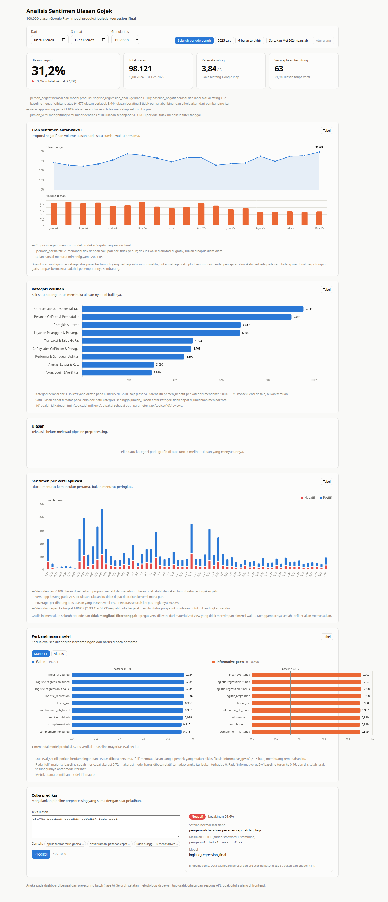

### Lampiran B — Berkas pendukung yang dapat dilampirkan

| Berkas | Isi |
|--------|-----|
| `ml/config.yaml` | Seluruh parameter proyek dalam satu berkas |
| `ml/artifacts/MANIFEST.json` | Hash data, snapshot konfigurasi, versi pustaka, seluruh metrik |
| `docs/tables/token_normalisasi_terisi.csv` | Kamus normalisasi slang hasil pemetaan manusia (gerbang H-5) |
| `docs/tables/error_analysis_50_reviewed.csv` | 50 kesalahan beserta kategori penyebab |
| `docs/tables/h9_hasil_kesepakatan.csv` | Data mentah validasi silang pelabelan |
| `docs/openapi.json` | Spesifikasi API |
| `docs/synthesis/facts.yaml` | Seluruh angka naskah beserta tabel sumbernya |

### Lampiran C — Confusion matrix pembanding

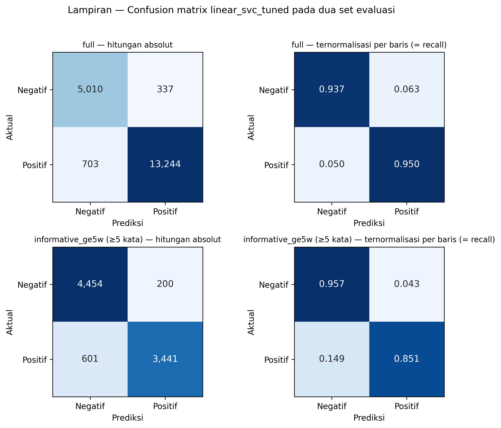

Model yang menjadi sumber 50 sampel analisis kesalahan (§5.2) adalah LinearSVC
hasil tuning, bukan model produksi. Taksonomi penyebab tetap berlaku lintas model:
indeks Jaccard antar-himpunan kesalahan keempat model menunjukkan kedua model
linear salah pada mayoritas baris yang sama (angka lengkapnya di
`docs/error_analysis.md` §4). Yang berbeda antar-model bukan *jenis* kasus yang
sulit, melainkan berapa banyak yang terjaring.
<!-- src: docs/error_analysis.md §4 -->
